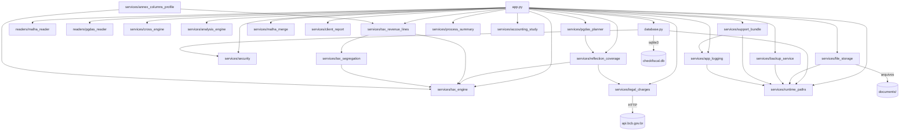

# Mapa de dependências

> Levantado por análise estática dos imports em 22/10/2026 (commit `bf35530`).

## 1. Grafo de imports de produção

Observações:

- **Não há ciclos.**
- **Os serviços fiscais não importam FastAPI nem `database`.** É a melhor propriedade do código atual e a base da migração.
- `reflection_coverage` importa `legal_charges` só para `standard_due_date`. Essa dependência puxa o cliente HTTP do BCB para o cálculo de cobertura e deve ir para um módulo de calendário fiscal.
- `runtime_paths` cria diretórios no import, e `database` cria o esquema no import. **Importar é um efeito colateral.**

## 2. Responsabilidades duplicadas

| Responsabilidade | Implementações | Risco |
|---|---|---|
| Índice de receitas por competência (o PA prevalece sobre o histórico) | `analysis_engine.build_revenue_index`, `cross_engine.build_revenue_index`, `tax_engine.build_revenue_timeline` | Três cópias da mesma regra fiscal. Uma correção feita em uma delas não chega às outras |
| `unique_notices_by_type` | `analysis_engine`, `cross_engine` | idem |
| `month_index` / `competence_from_index` | `pgdas_planner`, `reflection_coverage`, `tax_engine`, `tax_revenue_lines`, `tax_segregation`, `pgdas_reader` | Seis cópias; falta um objeto de valor `Competencia` |
| `parse_money_to_cents` | `malha_reader`, `pgdas_reader` | As duas usam `float` |
| `effective_analyses` | `accounting_study`, `client_report`, `process_summary` | Três versões de "qual análise vale" |
| Transição de status do processo | `app.upload_pgdas` (801–825), `app._refresh_process_after_pgdas_batch` (930–954), `app.confirm_analysis` (1580–1589) | **As cópias divergem**: `confirm_analysis` não trata `AWAITING_ANALYSIS_PGDAS` nem `AWAITING_EXCEPTION_REVIEW` |
| Montagem do contexto de análise (análise → confirmações → conclusões → cálculos → resumo) | `build_analysis_context` e cópias inline em `upload_pgdas` e `confirm_analysis` | idem |

## 3. Código sem uso em produção

| Símbolo | Linhas aprox. | Usado por |
|---|---|---|
| `tax_segregation.calculate_segmented_reflections` (e o módulo) | 835 | Testes e `tax_revenue_lines` |
| `annex_columns_profile` (módulo inteiro) | 223 | Testes |
| `tax_revenue_lines.calculate_revenue_line_reflections` | parte de 1.097 | Testes e `annex_columns_profile` |
| `cross_engine.cross_malha_with_pgdas` | ~150 | Testes |
| `accounting_study.validate_conclusion` | — | Importado em `app.py`, mas a rota está desativada (410) |
| `database.save_accounting_study_conclusion` | — | Testes |

São cerca de **2.000 linhas de motor fiscal sem caminho de produção**, mas com testes. Não devem ser apagadas: são o embrião do Fator R e da segregação. Devem ser isoladas como "motor experimental", sem rota e sem chamada a partir da UI, até haver validação de um contador.

## 4. Funções excessivamente grandes

| Função | Arquivo | Linhas | Faz |
|---|---|---|---|
| `upload_pgdas` | `app.py:639` | ~220 | Validação, leitura de PDF, identidade, persistência, armazenamento, evento, análise, cobertura, status e resposta |
| `confirm_analysis` | `app.py:1381` | ~255 | Mutação manual de quatro estruturas aninhadas da análise |
| `upload_pgdas_auto` | `app.py:957` | ~240 | Lote, paralelismo, laço de convergência |
| `analyze_malha` | `app.py:447` | ~190 | Identidade, merge, plano, armazenamento, evento |
| `read_pgdas_pdf` | `readers/pgdas_reader.py:1019` | ~580 | Leitor inteiro em uma função |
| `calculate_required_pgdas` | `pgdas_planner.py:383` | ~250 | Plano, validação e mensagens |
| `analyze_competence` | `analysis_engine.py:319` | ~240 | Regras dos Tipos 01 e 17 juntas |

## 5. Acoplamento entre API, regra e banco

- **A API conhece a forma interna da análise.** `confirm_analysis` (`app.py:1442–1540`) reescreve os campos `recommendation`, `actions`, `segregation.type_17` e `segregation.consolidated` à mão. Uma regra de negócio, "a revisão humana substitui a simulação", vive na camada HTTP.
- **O banco guarda o domínio como JSON livre** (`malha_json`, `pgdas_json`, `analysis_json`, `calculation_json`, `report_json`). Não há esquema versionado do conteúdo. A compatibilidade é mantida por aliases ("campos mantidos para compatibilidade", `analysis_engine.py:330`, `:465`).
- **GETs com escrita**: `ensure_current_pgdas_plan` grava ao ler, e `GET /api/client-report` grava relatório, status e evento.
- **O frontend depende de 15 rotas** e do formato JSON integral das respostas, sem esquema Pydantic de saída. Qualquer renomeação de campo quebra a UI sem aviso.
